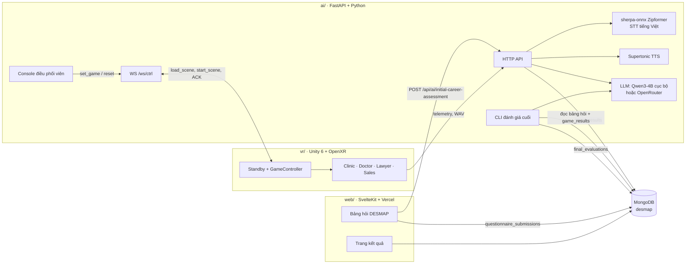

# DESMAP

DESMAP là hệ thống định hướng nghề nghiệp kết hợp **AI** và **thực tế ảo (VR)**, được xây dựng cho đề tài nghiên cứu khoa học (NCKH). Hệ thống so sánh hai nguồn dữ liệu về cùng một người tham gia:

1. **Tự đánh giá**: bảng hỏi DESMAP trên web.
2. **Hành vi quan sát được**: kết quả khi người tham gia thực hành công việc của một nghề trong mô phỏng VR.

Kết quả cuối kết hợp cả hai nguồn để đề xuất nghề phù hợp và giải thích lý do, thay vì chỉ dựa vào câu trả lời tự khai.

## Mô hình DESMAP

Bảng hỏi gồm 80 câu, chia thành 6 nhóm và 28 chiều (dimension):

| Nhóm | Ý nghĩa | Số chiều |
| --- | --- | --- |
| **D**esire | Mong muốn, điều người tham gia coi trọng ở công việc | 6 |
| **E**xpertise | Chuyên môn, điểm mạnh muốn phát huy | 6 |
| **S**ocial Role | Vai trò thường đảm nhận khi làm việc cùng người khác | 3 |
| **M**indset | Cách xử lý thông tin và ra quyết định | 3 |
| **A**daptability | Khả năng thích ứng với thay đổi | 4 |
| **P**ressure | Phản ứng khi công việc căng thẳng | 6 |

Riêng nhóm D được hiểu là *mức độ coi trọng* một yếu tố, không phải điểm cao/thấp tốt hay xấu. Thuật ngữ đầy đủ nằm trong [web/CONTEXT.md](web/CONTEXT.md).

## Quy trình đánh giá

```text
 Người tham gia            Web (SvelteKit)            AI backend (FastAPI)          Unity VR
 ──────────────            ───────────────            ────────────────────          ────────
 Chọn lĩnh vực quan tâm ─►
 Trả lời 80 câu DESMAP  ─► Tính 28 điểm chiều ──────► Đánh giá ban đầu (LLM)
                           Lưu MongoDB            ◄── tối đa 5 nghề gợi ý
                           Hiển thị kết quả ban đầu
                                                      Điều phối viên: set_game ───► Nạp và bắt đầu scene
 Thực hành nghề trong VR ────────────────────────────────────────────────────────►  Clinic / Doctor /
                                                      Nhận telemetry, ghi âm   ◄──  Lawyer / Sales
                                                      STT tiếng Việt, chấm điểm
                                                      Lưu game_results (MongoDB)
                                                      CLI đánh giá cuối:
                                                      bảng hỏi + kết quả VR
                                                      → final_evaluations
```

1. **Đánh giá ban đầu**: chỉ dựa trên bảng hỏi. Web gửi 28 điểm chiều tới AI backend; LLM trả về 1–5 nghề gợi ý kèm phần trăm phù hợp ước lượng. Khi tắt AI, web dùng phép tính trọng số có sẵn.
2. **Mô phỏng VR**: người tham gia chơi các mô phỏng nghề. Unity gửi kết quả và bản ghi âm câu nói về backend để nhận dạng giọng nói và chấm điểm theo rubric.
3. **Đánh giá cuối**: CLI `generate_final_evaluation.py` gộp bảng hỏi với mọi `game_results` của người tham gia. Python tính mức độ từng chiều, điểm DESMAP và điểm VR quan sát được, rồi xếp hạng 68 nghề trong danh mục lấy từ O\*NET 30.2. VR đóng góp tối đa 25%, theo tỷ lệ số tiêu chí thực sự quan sát được. LLM chỉ viết phần giải thích, không quyết định điểm phù hợp.

## Kiến trúc hệ thống



| Thành phần | Thư mục | Công nghệ | Vai trò |
| --- | --- | --- | --- |
| Web | `web/` | SvelteKit, TypeScript, Node.js 24, pnpm 12.4.1, triển khai trên Vercel | Trang giới thiệu, bảng hỏi, thư viện nghề, trang kết quả; lưu bài làm vào trình duyệt rồi đồng bộ MongoDB |
| AI backend | `ai/` | Python 3.14, FastAPI/Uvicorn, sherpa-onnx, llama.cpp/Lemonade, Supertonic, OpenRouter | Đánh giá ban đầu, nhận telemetry và ghi âm từ Unity, STT, chấm điểm, điều khiển scene, CLI đánh giá cuối |
| VR | `vr/` | Unity 6000.5.4f1, URP, XR Interaction Toolkit, OpenXR, NativeWebSocket | Các mô phỏng nghề; nhận lệnh từ backend và gửi kết quả về |
| Cơ sở dữ liệu | — | MongoDB | `questionnaire_submissions`, `game_results`, `final_evaluations` |

### Các mô phỏng VR

Ứng dụng luôn khởi động vào scene `Standby`. Scene gameplay chỉ chạy khi backend gửi lệnh `start_scene`.

| Scene | Nghề | Nội dung | Kết quả đo |
| --- | --- | --- | --- |
| `clinic` | Bác sĩ cấp cứu | Xử lý nhiều bệnh nhân trong phòng khám | Thời gian xử lý từng bệnh nhân, điểm vòng chơi |
| `doctor` | Bác sĩ | Hỏi bệnh và phân loại ghi chú | Độ chính xác phân loại, ghi chú thiết yếu |
| `lawyer` | Luật sư | Phỏng vấn thân chủ 4 lượt, nối chuỗi chứng cứ, trình bày bào chữa bằng giọng nói | Rubric 4 tiêu chí (chứng cứ, lập luận, bám kết luận, sức thuyết phục), trừ điểm khi phỏng vấn lại nhiều lần |
| `sale` | Nhân viên bán hàng | Phần 1: tư vấn và thuyết phục chọn giày. Phần 2: hội thoại bằng giọng nói với khách quay lại phàn nàn | Điểm thuyết phục; mức tin tưởng của khách tính từ sổ ghi bằng chứng (evidence ledger) |

Ở Sales phần 2, khách hàng ảo "Lan" trả lời bằng giọng nói tổng hợp. Mỗi câu nói của người chơi được nhận diện thành bằng chứng độc lập; điểm và kết quả cuối đều suy ra từ sổ bằng chứng này. Chi tiết: [ai/docs/sales-part2.md](ai/docs/sales-part2.md) và các ADR trong [ai/docs/adr/](ai/docs/adr/).

### Chế độ LLM

`PIPELINE_MODE` trong `ai/.env` chọn mô hình cho mọi tính năng LLM:

- `legacy` (mặc định) hoặc `shadow`: LLM cục bộ Qwen3-4B qua llama.cpp, hoặc Lemonade NPU + iGPU khi `LLM_USE_AMD_HYBRID=true`.
- `openrouter`: `deepseek/deepseek-v4.1-flash` qua OpenRouter, cần `OPENROUTER_API_KEY`. Supertonic TTS vẫn chạy cục bộ.

## Cấu trúc repo

```text
DESMAP/
├── web/      Ứng dụng web SvelteKit (bảng hỏi, kết quả)
├── ai/       Backend FastAPI, CLI đánh giá cuối, dữ liệu danh mục nghề
├── vr/       Dự án Unity VR
└── docs/     Hồ sơ nhập repo và làm sạch lịch sử
```

Mỗi thư mục con có `README.md`, `CONTEXT.md` (thuật ngữ miền) và tài liệu chi tiết riêng.

## Cài đặt sau khi clone

| Thư mục | Công cụ | Dependency |
| --- | --- | --- |
| `web/` | Node.js 24.x, pnpm 12.4.1 | Giữ nguyên package manifest và lockfile pnpm |
| `ai/` | Python 3.14 | `requirements.lock.txt` giữ đủ 47 phiên bản runtime của môi trường nguồn |
| `vr/` | Unity 6000.5.4f1 | Unity Package Manager và asset cục bộ trong `Assets/ThirdParty/` |

Cần thêm một MongoDB mà cả Web và AI đều truy cập được.

### Web

```powershell
Copy-Item .\web\.env.example .\web\.env
pnpm --dir .\web install --frozen-lockfile
pnpm --dir .\web dev
pnpm --dir .\web check
pnpm --dir .\web exec vitest run src
pnpm --dir .\web build
```

Biến môi trường chính trong `web/.env`:

```env
AI_BACKEND_URL=http://127.0.0.1:8000/api/ai/initial-career-assessment
DISABLE_AI_INIT_ASSESSMENT=false
MONGODB_URI=mongodb://127.0.0.1:27017
MONGODB_DATABASE=desmap
```

Web quản lý dependency trong `web/`, không có pnpm workspace ở gốc. Giữ cả hai tài liệu YAML trong lockfile hiện tại. `.env` cục bộ bị ignore. Khi triển khai Web, đặt Root Directory là `web`.

Lệnh `pnpm --dir web test` còn chạy script tái hiện lỗi trong `.scratch/mongodb-schema-repro.test.ts`, cần `MONGODB_URI`. Lệnh Vitest ở trên chạy bộ unit test ứng dụng trong `src/`.

### AI

```powershell
Set-Location .\ai
Copy-Item .env.example .env
python -m venv .venv
.\.venv\Scripts\python.exe -m pip install -r requirements.lock.txt
.\.venv\Scripts\python.exe -m app.main
.\.venv\Scripts\python.exe .\scripts\run_tests.py
```

`python -m app.main` mở API tại `http://127.0.0.1:8000` cùng console điều phối viên. Lần đầu chạy, dùng các lệnh console sau:

```text
ai setup            cài model STT Zipformer và Supertonic
ai start            khởi động LLM cục bộ và Supertonic
test_llm            kiểm tra LLM
set_game lawyer     chuyển Unity sang scene lawyer
reset all           đưa Unity về Standby
```

Sinh đánh giá cuối từ dữ liệu MongoDB (`--dry-run` để xem trước, không ghi DB):

```powershell
.\.venv\Scripts\python.exe .\scripts\generate_final_evaluation.py
```

`requirements.txt` gốc được giữ nguyên; `requirements.lock.txt` bổ sung 20 dependency gián tiếp cho Windows x64/Python 3.14. `.env`, môi trường ảo, model, recording và runtime backup nằm ngoài Git. Danh sách biến môi trường đầy đủ nằm trong [ai/readme.md](ai/readme.md).

### Unity VR

Mở `vr/` bằng Unity 6000.5.4f1 sau khi khôi phục asset bên thứ ba. Các asset này nằm trên máy tại `vr/Assets/ThirdParty/`, được ignore cùng `.meta` của thư mục cha. Danh sách thư mục và GUID nằm trong `vr/ThirdPartyAssets.json`.

Ví dụ khôi phục từ bản backup cục bộ trước khi làm sạch:

```powershell
.\vr\Restore-ThirdParty.ps1 -Source "<thư mục backup>\vr\Assets"
```

Script hỗ trợ nguồn là thư mục `Assets` cũ hoặc thư mục `Assets/ThirdParty` đã gom, chuyển kèm `.meta` và kiểm tra GUID.

Trong scene `Standby`, chọn **Game Controller** và đặt **Backend Base URL** tới AI backend, ví dụ `http://192.168.1.10:8000`. Xem [hướng dẫn VR](vr/README.md) cho các thao tác Unity khác.

```powershell
.\vr\Build.ps1 -Target Validate
.\vr\Build.ps1 -Target EditModeTests
.\vr\Build.ps1 -Target PlayModeTests
.\vr\Build.ps1 -Target Windows
.\vr\Build.ps1 -Target Android
```

NativeWebSocket giữ nguyên trong `vr/Assets/WebSocket/` và `vr/Assets/package.json`. Asset tự tạo, scene, prefab và GUID vẫn được quản lý trong Git. Binary được giữ lại dùng Git thường; clone/push repo này không cần Git LFS.

`Library/`, `Temp/`, `Build/`, `Builds/`, `Logs/`, `UserSettings/`, `Artifacts/`, `TestResults/`, screenshot QA và scene `_Recovery/` nằm ngoài Git.

### Thứ tự chạy toàn hệ thống

1. Khởi động MongoDB.
2. Chạy AI backend (`python -m app.main` trong `ai/`), rồi `ai setup` và `ai start` nếu cần.
3. Chạy Web (`pnpm --dir .\web dev`), người tham gia làm bảng hỏi.
4. Mở ứng dụng VR. Khi Unity đã kết nối, dùng `set_game <scene>` trong console để bắt đầu từng mô phỏng.
5. Chạy `generate_final_evaluation.py` để tạo đánh giá cuối.

## Lịch sử và bản sao dự phòng

Monorepo được tạo từ ba repo bằng `git subtree` (không squash). Lịch sử sau đó được làm sạch bằng `git filter-repo` để loại asset bên thứ ba, output QA và Git LFS.

Ba repo gốc vẫn giữ nguyên tại `<repo NCKH Web>`, `<repo NCKH AI>` và `<repo NCKH VR>`.

Bản sao trước khi làm sạch: `<thư mục backup>`. Bản này chứa working copy, Git/LFS và `all-refs.bundle`. Mọi branch/tag trong monorepo đã được lọc; SHA commit trước khi lọc chỉ còn dùng để tra cứu trong backup.

Khi đồng bộ tiếp từ repo gốc, hãy lọc bản xuất nguồn theo cùng chính sách trước khi dùng subtree. Pull trực tiếp lịch sử chưa lọc sẽ đưa lại asset bị loại và pointer LFS cũ vào monorepo.

Thông tin gốc nằm trong [sources.json](docs/migration/sources.json). [Báo cáo nhập repo ban đầu](docs/migration/verification.md) là snapshot trước lần làm sạch này. Kết quả kiểm tra lần làm sạch được ghi tại [public-cleanup.md](docs/migration/public-cleanup.md). Các test Unity đã chạy đầy đủ và còn lỗi scene/gameplay, xem báo cáo để biết chi tiết.

## Giấy phép dữ liệu

Hồ sơ nghề trong `ai/data/` lấy từ O\*NET® 30.2 (CC BY 4.0). Giữ thông tin ghi nguồn O\*NET ở mọi nơi hiển thị kết quả.
