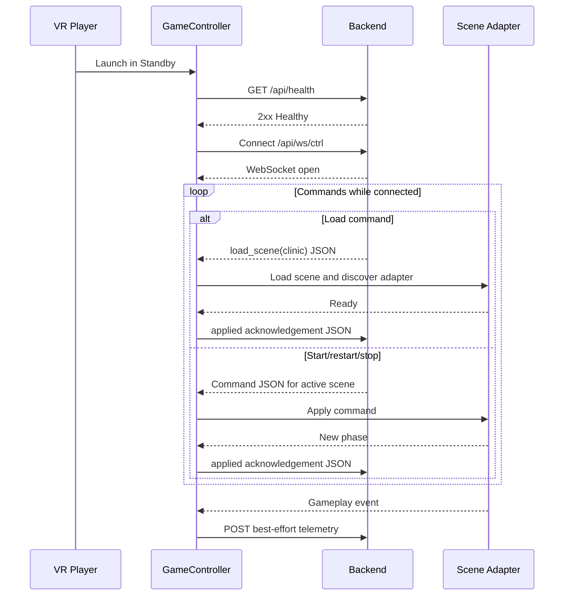

# NCKH VR

NCKH VR is a Unity 6 virtual-reality training project with backend-controlled gameplay scenes:

- `clinic` — emergency clinic gameplay in `Assets/Scenes/Doctor/Game 1.unity`
- `doctor` — patient interview and note-classification gameplay in `Assets/Scenes/Doctor/Game 2.unity`
- `lawyer` — four-wave client interview, evidence-chain board, and recorded closing defense
- `sale` — customer interview and sales-persuasion gameplay

The application always launches into `Assets/Scenes/Standby.unity`. A persistent controller receives commands from a separate backend over WebSocket, loads the requested scene, and starts, restarts, or stops its round. Gameplay scenes do not start automatically. A loaded gameplay scene displays `ĐANG CHỜ BẮT ĐẦU` until it receives `start_scene`.

## Local third-party assets

Restore `Assets/ThirdParty/` before opening this project or running its tests. This ignored folder contains imported art, audio, TextMesh Pro resources, Unity templates, and XRI samples. Its folders retain their original `.meta` GUIDs; `ThirdPartyAssets.json` records the layout.

```powershell
.\Restore-ThirdParty.ps1 -Source "<backup>\Assets"
```

The source can be an old `Assets/` directory or an existing `Assets/ThirdParty/` directory. The restore script validates folder GUIDs and keeps `.meta` files. If an asset has moved within the source, the script locates it by GUID and restores nested manifest entries separately to avoid duplicate GUIDs. All sources are checked before copying begins. Unity creates the new parent folder metadata on first import. NativeWebSocket remains tracked at its existing location. Git LFS is no longer used; retained project binaries are regular Git blobs.

## Requirements

| Component | Version |
| --- | --- |
| Unity Editor | `6000.5.4f1` |
| Universal Render Pipeline | `17.5.0` |
| XR Interaction Toolkit | `3.5.1` |
| XR Plug-in Management | `4.7.0` |
| OpenXR | `1.17.1` |
| Input System | `1.19.0` |

The authoritative versions are in `ProjectSettings/ProjectVersion.txt` and `Packages/manifest.json`.

## Build and verification

Run the project wrapper from PowerShell. It resolves the required Unity installation automatically.

```powershell
powershell -ExecutionPolicy Bypass -File .\Build.ps1 -Target Validate
powershell -ExecutionPolicy Bypass -File .\Build.ps1 -Target EditModeTests
powershell -ExecutionPolicy Bypass -File .\Build.ps1 -Target PlayModeTests
# Limit checks to the affected fixture when testing a small change.
powershell -ExecutionPolicy Bypass -File .\Build.ps1 -Target PlayModeTests -TestFilter "NCKH.VR.Sales.Tests.SalesPart2FlowTests"
powershell -ExecutionPolicy Bypass -File .\Build.ps1 -Target Windows
powershell -ExecutionPolicy Bypass -File .\Build.ps1 -Target Android
```

## NPC poses and animations

`Casual NPC.prefab` includes an inactive `NpcMotionPlayer`. Configure it on a prefab instance when a game needs a specific pose or animation:

1. Choose `None`, `Static Humanoid Pose`, or `Animation Clip` in the component.
2. For an imported animation, assign a Humanoid `AnimationClip`, then configure speed and looping.
3. For a hand-authored pose, run **Tools > NCKH VR > NPC > Create Base Humanoid Pose Rig**, adjust the rig's humanoid bones in a temporary scene, and run **Capture Selected Humanoid Pose**.
4. Assign the captured pose asset to `NpcMotionPlayer`. Optionally assign a camera or other Transform as the constrained head-tracking target.

Motion is applied to whichever randomized model is created at runtime. Keep per-game pose assets, model offsets, look targets, and collider dimensions as scene-instance overrides unless every use of the prefab needs the same behavior.

## Game-control configuration

Select **Game Controller** in the Standby scene and configure these serialized fields before building:

| Field | Default | Purpose |
| --- | --- | --- |
| Backend Base URL | empty | Absolute `http://` or `https://` URL of the control server |
| Health Route | `/api/health` | HTTP health-check route |
| Telemetry Route | `/api/telemetry` | HTTP telemetry route |
| Control WebSocket Route | `/ws/ctrl` | Bidirectional command and acknowledgement route |
| TTS WebSocket Route | `/ws/tts` | Reserved for future text-to-speech support |
| STT WebSocket Route | `/ws/stt` | Reserved for future speech-to-text support |
| Request Timeout | 10 seconds | Timeout for HTTP requests and the WebSocket handshake |
| Disconnect Grace | 10 seconds | Continuous outage before an active round is stopped |
| Maximum Reconnect Delay | 10 seconds | Cap for exponential reconnect backoff |
| Scene Catalog | `standby`, `clinic`, `doctor`, `lawyer`, `sale` | Case-insensitive API ID to Unity scene-path mapping |

An empty or invalid backend URL or route, duplicate scene ID, or incomplete catalog entry disables networking and displays a configuration error in Standby. Route values may include or omit the leading slash. WebSocket URLs automatically use `ws://` for an HTTP base URL and `wss://` for HTTPS.

## Architecture

`GameController` survives scene changes and owns the health, control WebSocket, and telemetry clients. It resolves backend scene IDs through the serialized catalog and discovers one `IGameSceneAdapter` after a gameplay scene loads. The clinic and doctor adapters translate generic commands into their existing managers' `StartRound` and `StopRound` methods and translate gameplay events into common telemetry envelopes.



### Runtime components

- **GameController** — configuration, scene catalog, control WebSocket, command validation, acknowledgements, reconnect policy, and telemetry publishing.
- **IGameSceneAdapter** — scene-independent start, restart, stop, phase, and telemetry contract.
- **ClinicRemoteSceneAdapter / DoctorRemoteSceneAdapter** — gameplay-specific manager integration.
- **StandbyStatusView** — title, waiting instruction, and live backend status rendered as a centered, head-locked HUD against a completely black Standby scene.
- **Gameplay managers** — remain responsible for round rules, timing, scoring, interaction, and result UI.

## Backend API

The game initiates all HTTP and WebSocket connections to the backend. The backend does not connect directly to the headset.

### Check backend health

```http
GET {baseUrl}/api/health
```

Return any `2xx` response when the backend is ready to accept the control WebSocket and telemetry requests. The body is ignored. The game requires a successful health check before opening or reopening the control socket.

### Open the control WebSocket

```text
ws://{baseAuthority}/ws/ctrl
wss://{baseAuthority}/ws/ctrl
```

The client appends no query parameters. Send each command as one UTF-8 text message containing the raw command JSON:

```json
{
  "commandId": "e0fa94f2d7844b96b93363b7d46b61a5",
  "sequence": 42,
  "type": "load_scene",
  "sceneId": "clinic",
  "issuedAtUtc": "2026-08-17T12:00:00.0000000Z"
}
```

| Command | Behavior |
| --- | --- |
| `load_scene` | Loads the catalog scene in Single mode. The acknowledgement waits for scene readiness. Loading the active scene ID is idempotent. |
| `start_scene` | Starts an idle manager in the matching active scene. |
| `restart_scene` | Stops if necessary, resets, and starts the matching active manager without reloading the scene. |
| `stop_scene` | Stops the matching active round and leaves its result UI visible. |
| `reset_scene` | Loads Standby in Single mode, resets the active target (or every gameplay scene for `sceneId: "all"`), and remains in Standby. |

Every command must include a known `sceneId`. Start, restart, stop, and specific reset commands are rejected if their target is not the active logical scene. `reset_scene` additionally accepts `all`, but rejects `standby`. Standby is never reset. Gameplay state owned by the loaded scene resets through Single-mode unloading; persistent gameplay state uses the reset registry. A successful reset acknowledgement is delayed until Standby is active and reports `sceneId: "standby"` and `phase: "standby"`.

### Acknowledge a command

Unity sends one UTF-8 text message back over the same `/ws/ctrl` socket after applying the command:

```json
{
  "sequence": 42,
  "status": "applied",
  "sceneId": "clinic",
  "phase": "ready",
  "appliedAtUtc": "2026-08-17T12:00:01.0000000Z",
  "errorCode": "",
  "errorMessage": ""
}
```

`status` is `applied`, `rejected`, or `failed`. Rejections include stable codes such as `unknown_scene`, `unknown_command`, `scene_mismatch`, `scene_not_controllable`, `invalid_phase`, and `missing_manager`.

Acknowledgements are control-critical. The client reconnects with bounded exponential backoff and prioritizes an unsent acknowledgement before processing another command. Duplicate command IDs received during the same launch return the cached acknowledgement without reapplying the command.

### Publish telemetry

```http
POST {baseUrl}/api/telemetry
Content-Type: application/json
```

```json
{
  "schemaVersion": 1,
  "eventId": "492e69f70c714d1783b7ab932628f1db",
  "sessionId": "0b7fb6ce7aee4c10b003e9b14def8953",
  "occurredAtUtc": "2026-08-17T12:00:10.0000000Z",
  "sceneId": "clinic",
  "phase": "running",
  "eventType": "clinic.patient_resolved",
  "payload": {
    "roundId": "3a90a66c95fc4fe7b055c44980230ac1",
    "patientId": "3",
    "sicknessName": "Cardiac Arrest",
    "resolution": "cured",
    "severity": 4,
    "scoreDelta": 8,
    "scoreTotal": 14,
    "remainingTime": 21.5
  }
}
```

Telemetry is best effort. Failed events are not persisted or retried. At most four telemetry requests are in flight; excess events are dropped with an aggregated Unity warning.

### Event catalog

Common events:

- `client.started`, `client.heartbeat`
- `backend.connected`, `backend.disconnected`
- `command.received`, `command.applied`, `command.rejected`, `command.failed`
- `scene.load_started`, `scene.ready`
- `game.restarted`, `game.stopped`

Clinic events:

- `clinic.round_started`, `clinic.round_finished`
- `clinic.patient_spawned`, `clinic.patient_resolved`

Doctor events:

- `doctor.round_started`, `doctor.round_finished`
- `doctor.case_presented`, `doctor.question_asked`
- `doctor.card_placement_changed`, `doctor.case_submitted`

Doctor telemetry uses case asset names, question/card IDs, categories, and scores. It does not transmit dialogue transcripts or other player-facing free text.

Lawyer flow:

- The player chooses one of five questions in each of four waves. A choice is permanent for that interview attempt and unlocks one authored clue.
- The evidence gate accepts four strong clues or three strong plus one weak clue. Noise clues fail the gate and show `CHƯA ĐỦ CHỨNG CỨ` with `Phỏng vấn lại`.
- Restarting the interview retains the six initial clues and round ID, clears interview and board progress, and increments `interviewRestartCount`.
- The evidence board accepts the three adjacent links in the configured four-clue chain in any interaction order, while assessment data keeps the configured wave order.
- The 60-second closing defense sends the ordered evidence, reasoning cards, five positive sample answers, and restart count through `lawyer.defense_recording`. Unity polls the gameplay-safe Lawyer status endpoint and shows only processing, retry, or completion state.

## Backend responsibilities

- Maintain one FIFO command queue for the game client.
- Return a `2xx` health response only when the control WebSocket and telemetry endpoint are ready.
- Return only one unacknowledged command at a time.
- Keep the same command ID and sequence until a terminal acknowledgement arrives.
- Treat repeated acknowledgements as idempotent.
- Enqueue `restart_scene` explicitly after a disconnect has stopped an active round.

## Failure behavior

- Startup health-check failures leave the player in Standby and retry indefinitely.
- WebSocket failures return the controller to health checks before reconnection.
- Reconnection uses exponential backoff capped at the configured maximum delay.
- Ten continuous seconds of outage during a running round stop that round once and leave the result scene visible.
- Natural round completion never changes scene automatically.
- Malformed commands are rejected where a command ID is available; responses without a command ID are logged and ignored.
- Unknown scene IDs and invalid phase transitions never trigger a scene change.

## LAN transport security

The Android player permits cleartext HTTP and WebSocket traffic to support trusted local networks. The API has no authentication token, so health checks, commands, and telemetry are neither authenticated nor encrypted. Use this mode only on an isolated trusted LAN; use HTTPS/WSS and add authentication before exposing the backend outside that network.

## Local integration checklist

1. Configure the Standby `GameController` with the backend URL.
2. Start the backend and confirm `/api/health` returns `2xx`.
3. Confirm `/ws/ctrl` accepts a WebSocket connection without query parameters.
4. Send `load_scene` for `clinic` or `doctor` and wait for an `applied`/`ready` acknowledgement on the socket.
5. Send `start_scene` for the same scene ID.
6. Confirm lifecycle and gameplay telemetry arrives at `/api/telemetry`.
7. Send `stop_scene`, `restart_scene`, `reset_scene`, or `load_scene` for `standby`; confirm reset remains in Standby and does not start another round.

## Headset verification

Editor tests cannot verify physical comfort or Android network conditions. Before deployment, verify on the target headset:

- Standby is the first visible scene, the environment is completely black, and headset tracking remains stable.
- The centered head-locked HUD is readable in both eyes; locomotion and hand/controller visuals remain disabled in Standby.
- LAN cleartext HTTP and WebSocket traffic reaches the configured server.
- Scene transitions do not cause an uncomfortable camera offset or recenter.
- Controller bindings and interaction remain correct in both gameplay scenes.
- A sustained backend outage stops the round after the configured grace period.

If the player remains on the configuration warning, check the serialized base URL and API routes. If commands are rejected, confirm the catalog ID, active scene, and manager phase. For Android connection failures, confirm the headset and server share a reachable LAN and that the URL uses the server's LAN address rather than `localhost`.
